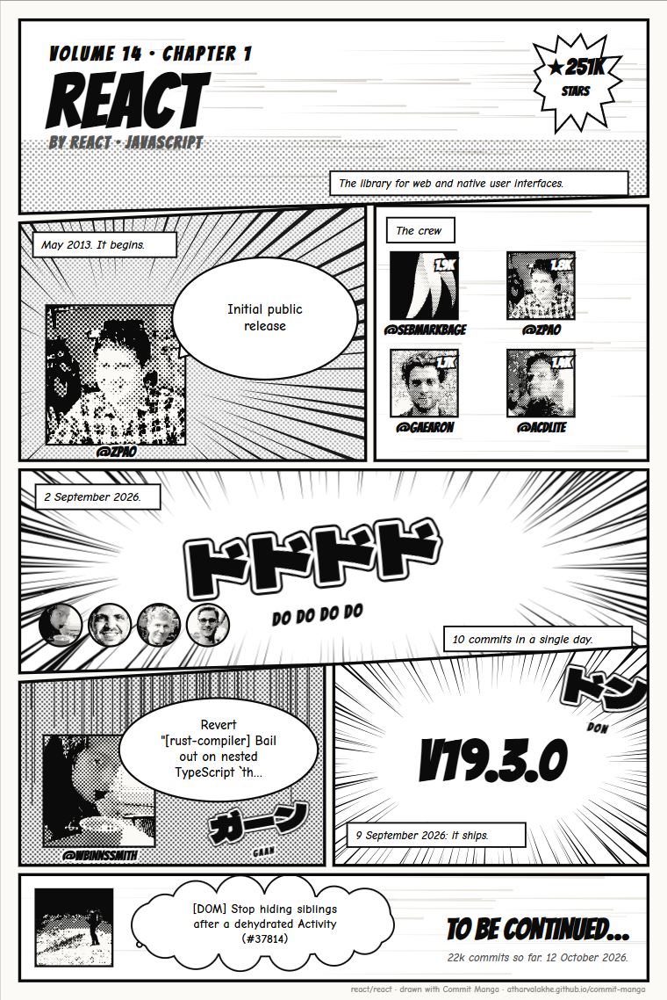
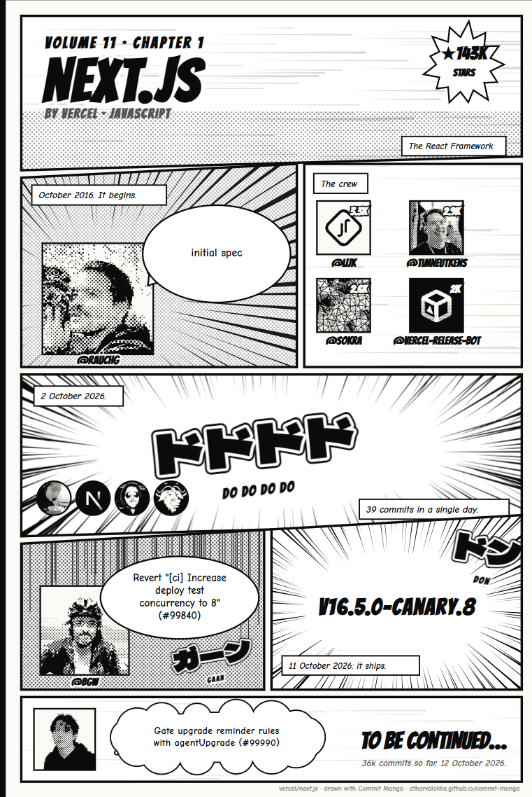

<h1 align="center">Commit Manga</h1>

<p align="center"><b>Any GitHub repository's history, drawn as a black-and-white manga page.</b><br>
The founder, the crew, the busiest day, the drama, the release and the cliffhanger, in seven panels.</p>

<p align="center">
  <a href="https://atharvalakhe.github.io/commit-manga/"><b>Draw one now</b></a> &nbsp;&nbsp;
  <a href="https://atharvalakhe.github.io/commit-manga/?repo=facebook/react">React</a> &nbsp;&nbsp;
  <a href="https://atharvalakhe.github.io/commit-manga/?repo=torvalds/linux">Linux</a> &nbsp;&nbsp;
  <a href="https://atharvalakhe.github.io/commit-manga/?repo=vercel/next.js">Next.js</a>
</p>

<p align="center">
  <a href="https://github.com/AtharvaLakhe/commit-manga/actions/workflows/ci.yml"></a>
  
  
  <a href="LICENSE"></a>
</p>

<table>
<tr>
<td width="50%"><a href="https://atharvalakhe.github.io/commit-manga/?repo=facebook/react"></a></td>
<td width="50%"><a href="https://atharvalakhe.github.io/commit-manga/?repo=vercel/next.js"></a></td>
</tr>
</table>

## The seven panels

| Panel | What it shows | Where it comes from |
|---|---|---|
| **Title** | Volume number (one per year of the repo), name, owner, language, stars and description | The repository |
| **It begins** | Whoever made the first commit, saying its message | The oldest commit on the default branch |
| **The crew** | The top four contributors as ink portraits, with their commit counts | Contributors, bots left out |
| **ドドドド** | The day the commits piled up, and who was there | The busiest day in the last 200 commits |
| **The drama** | The most dramatic recent commit, with its sound effect | Reverts get ガーン, "oops" gets ギクッ, hotfixes get ドキドキ, "finally" gets ドン, plain fixes sweat |
| **It ships** | The latest release, or the stars and forks if there's never been one | Releases |
| **To be continued…** | The newest commit, as a thought, and the commit count so far | The default branch |

## How it works

- **Six requests.** Everything is read from the GitHub REST API in your browser: the repo, two pages of recent commits, the first commit, contributors and releases. Finding the very first commit of a 1.5-million-commit repo takes one request: ask for one commit per page and jump to the last page named in the `Link` header.
- **Ink portraits.** Each avatar goes through a small halftone renderer on a canvas: contrast is stretched between the 5th and 95th percentile, shadows become solid ink, mid-tones become a 45° screentone of dots sized by brightness, and highlights stay paper.
- **Manga vocabulary, in SVG.** Focus lines, speed lines, gloom lines, starbursts, speech and thought bubbles, caption boxes and two-tone sound effects are all drawn as SVG, seeded by the repo name so a repo always gets the same page.
- **Exports that look the same everywhere.** Downloading the SVG or PNG fetches the three fonts and embeds them, so the page doesn't depend on what's installed on the reader's computer.
- **No server, no build step.** It's static files on GitHub Pages: an HTML page and four ES modules.

## Run it yourself

```bash
git clone https://github.com/AtharvaLakhe/commit-manga && cd commit-manga
python -m http.server 8000      # or any static server
# open http://localhost:8000/?repo=owner/name
npm test                         # node 18 or newer
```

Visitors without a token get GitHub's 60 requests an hour, about ten pages. The page has a field for a token with no scopes, which stays in the browser and raises that to 5,000.

## Credits

Fonts: [Bangers](https://fonts.google.com/specimen/Bangers), [Comic Neue](https://fonts.google.com/specimen/Comic+Neue) and [Dela Gothic One](https://fonts.google.com/specimen/Dela+Gothic+One), all under the SIL Open Font License, loaded from Google Fonts. Avatars belong to their owners and are loaded from GitHub at draw time.

Made by [Atharva Lakhe](https://github.com/AtharvaLakhe). See also [inkgraph](https://github.com/AtharvaLakhe/inkgraph), which draws your GitHub year as an animated ink banner. MIT licence.
